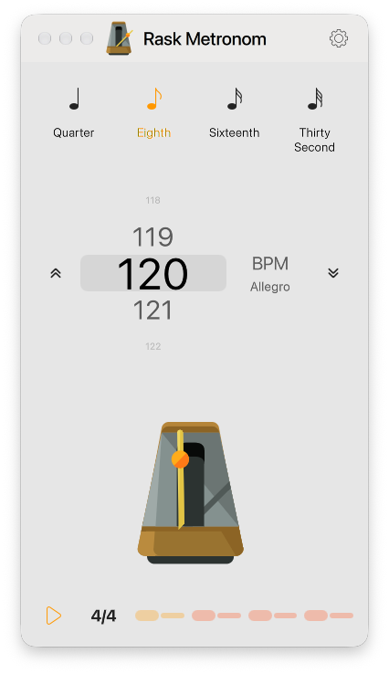
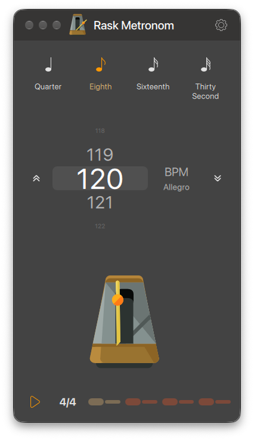
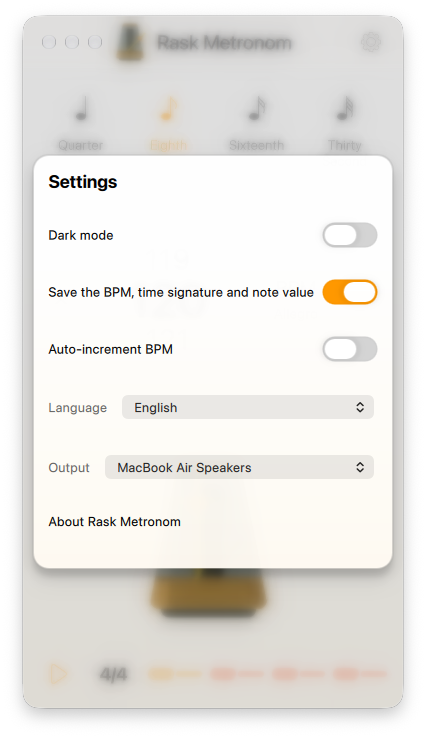
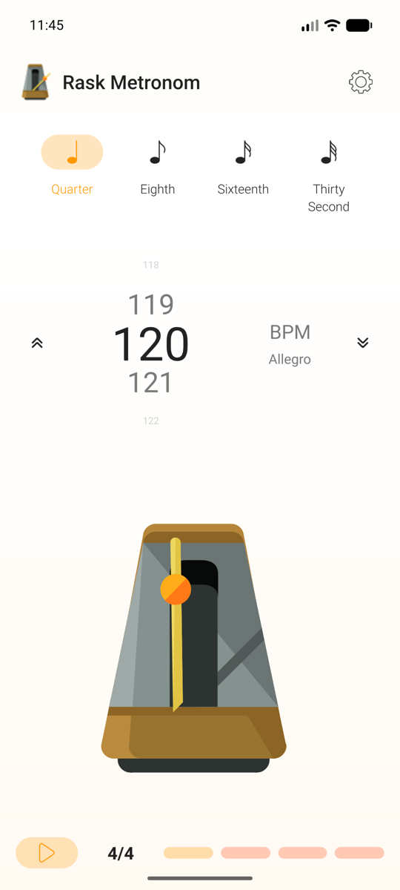
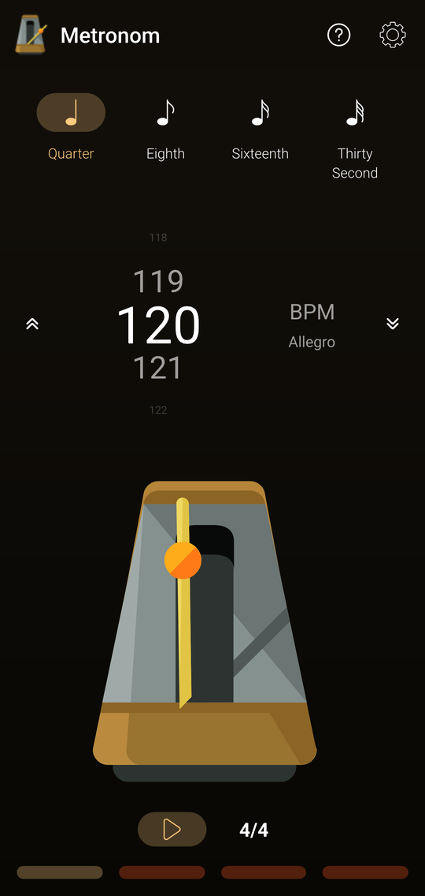
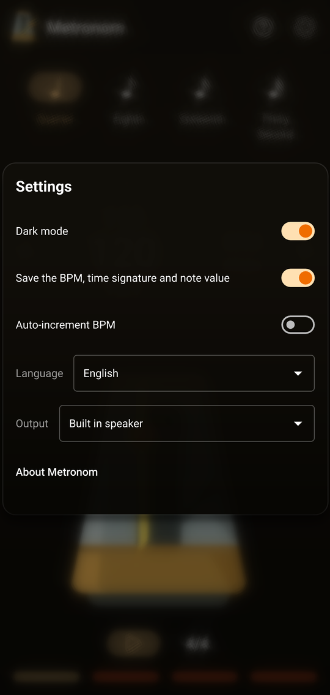
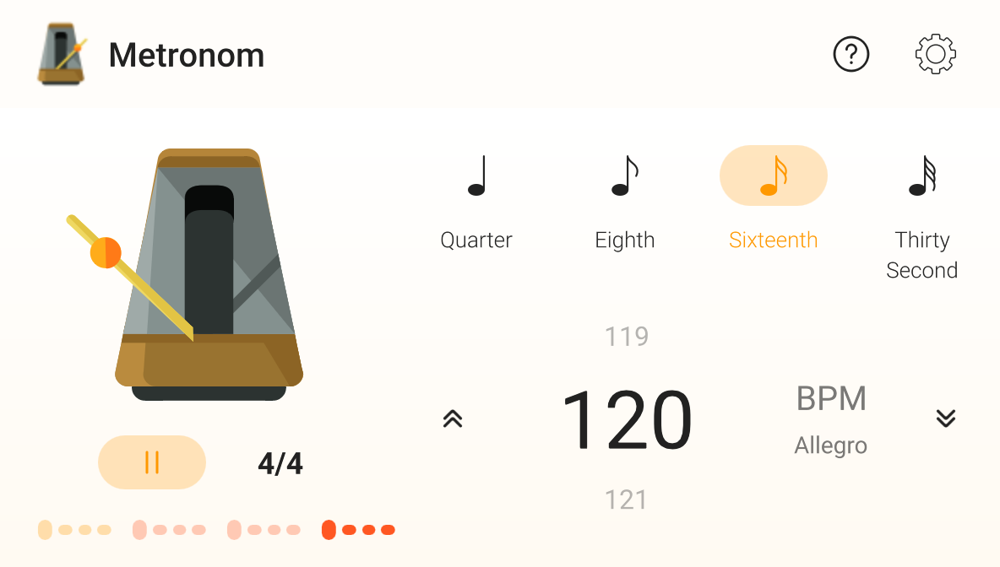

  

# Rask Metronom

**Website:** <https://rask-project.github.io/metronom/> — features, downloads and a guide to tempo, time signatures and note values.

A cross-platform metronome for desktop (Linux, Windows, macOS) and Android, built with **Qt 6** (Qt Quick / QML) and **C++23**. It uses the Material style on Android and Linux and a native-looking macOS style on macOS.

## Screenshots

### macOS

  
  
  

### Android

  
  
  

  

More, including the time signature dialog, in <a href="docs/screenshots">docs/screenshots</a>.

## Features

- BPM control with tempo markings (Largo → Prestissimo)
- Note values: quarter, eighth, sixteenth and thirty-second
- Accented downbeat in 4/4
- Audio output device selection
- Automatic BPM increment at a configurable interval
- Screen-lock inhibition while running
- Light / dark / system theme
- Adaptive layout for portrait and landscape
- Translations: English (source), Brazilian Portuguese, Spanish, French and Italian
- Persistent settings (BPM, note value, theme, language)

## Architecture

The app is split into two QML modules with a strict separation of concerns: all business logic lives in C++, QML stays declarative.

### `metronom_qml` — C++ core (QML module `Metronom`)

A static library exposing the engine and platform services as `QML_ELEMENT`s:

| Class | Responsibility |
|---|---|
| `Metronome` | Metronome engine: BPM, note value, beat scheduling, audio output |
| `ScreenLockInhibitor` | Keeps the screen on while running (platform-specific) |
| `StatusBarController` | Android status-bar light/dark adaptation |
| `LanguageManager` | Language selection (applied on restart) |
| `Appearance` | Light / dark / system choice, applied with `QStyleHints::setColorScheme` |
| `Theme` (QML) | App colours, independent of the Controls style |

#### Audio engine

`Metronome` renders audio through a `QAudioSink` (44.1 kHz, stereo; sample format — 16-bit int or 32-bit float — negotiated with the device):

- **Sample-accurate scheduling** — ticks are scheduled against a sample counter, not wall-clock timers, so there is no drift between the audio clock and the beat grid.
- **Pre-rendered clicks** — the strong (downbeat) and weak clicks are rendered once as exponentially decaying sine bursts and mixed into the output buffer; the hot path performs zero allocations.
- **Device switching** — the unplayed tail of the current buffer is carried over when the output device changes.

#### Screen-lock inhibition

`ScreenLockInhibitor` is a plain C++ class with per-platform backends:

- **Linux** — D-Bus: `org.freedesktop.ScreenSaver` (KDE Plasma, most X11 desktops) and the `org.freedesktop.portal.Inhibit` portal (GNOME, Flatpak), on both X11 and Wayland.
- **macOS** — IOKit power assertion.
- **Windows / Android** — no-op (handled by the platform).

### App module (QML)

| File | Role |
|---|---|
| `main.cpp` | Entry point: application metadata, Controls style, locale + translator, icon theme; loads `App.Splash` |
| `Splash.qml` | Splash window that loads the main window behind it |
| `Main.qml` | Main window: adaptive layout, `Settings` persistence, theming |
| `Controls/` | Shared UI: `Background`, `Header`, `SettingsDialog`, `TimeSignatureDialog`, `AboutDialog` |
| `Metronom/*.qml` | Feature controls: `BpmControl`, `NoteValueSelector`, `Transport`, `Metronom` (visual), `AudioDeviceSelector`, `LanguageSelector`, `AutoIncrementControl` |

### Controls style

The style is selected at run time in `main.cpp`: **Material** on Android and Linux, **`MacStyle`** on macOS. `MacStyle` (`MacStyle/`) builds on Qt's macOS style, whose controls are drawn by AppKit, and adds the controls it lacks or draws unlike a native app — `Button` (flat), `RoundButton`, `ToolButton`, `Tumbler`, `ToolTip`, `SwitchDelegate` and `ItemDelegate`.

### Internationalization

The source language is English. Translations live in `translations/*.ts` (pt_BR, es_ES, fr_FR, it_IT), are compiled into `:/i18n/*.qm` by `qt_add_translations`, and are selected at startup from the `language` setting (falling back to the system locale).

### Build

CMake (≥ 3.16) with Qt ≥ 6.10 (`Quick`, `QuickControls2`, `Multimedia`, `QmlIntegration`, `LinguistTools`; `DBus` optional). Android builds use the Gradle project under `android/`.

## AI-assisted development

This project was developed with the assistance of an AI coding agent powered by the **Qwen 3.8 27B** model, running locally via **llama.cpp**.

## License

Released under the [MIT License](LICENSE).
